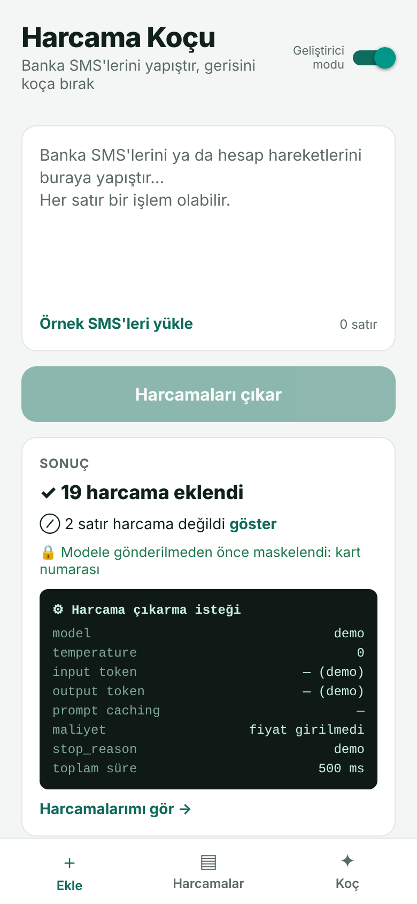
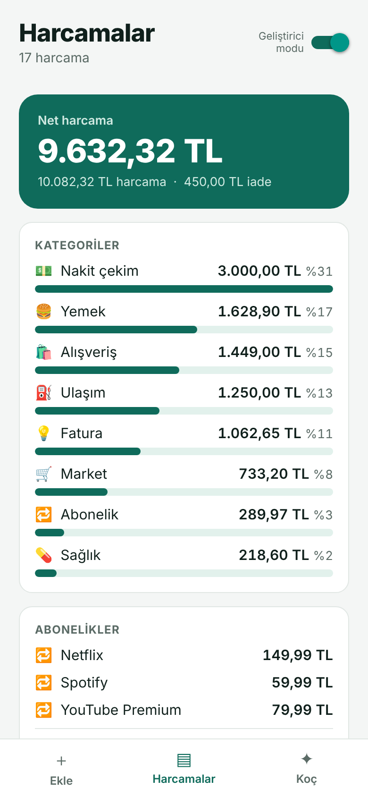
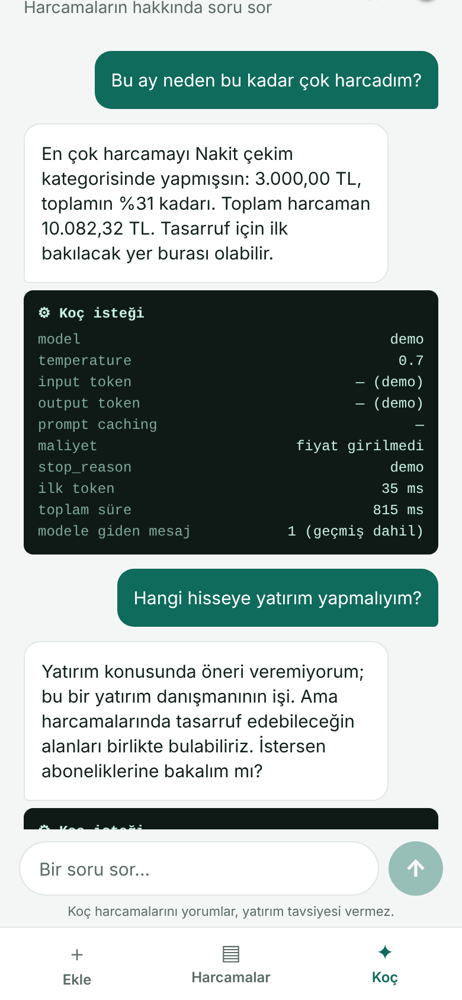

# Harcama Koçu 💸

**AI Engineer Oluyoruz** serisinde 5 günde öğrendiklerimizi tek bir mobil uygulamada birleştirdiğimiz proje.

Banka SMS'lerini yapıştırıyorsun; uygulama harcamaları çıkarıp kategorilere ayırıyor, özetini gösteriyor ve harcamaların hakkında bir koçla sohbet etmeni sağlıyor.

| Ekle | Harcamalar | Koç |
|---|---|---|
|  |  |  (screenshots/5.png) |

## Projenin en önemli kuralı

> **Model okur ve konuşur, kod hesaplar.**

Model SMS'ten tutarı metin olarak çıkarıyor (`"1.250,00"`), onu sayıya çeviren, toplayan ve yüzdeyi hesaplayan kod. Koç da toplamları kendisi hesaplamıyor; kodun hazırladığı özeti yorumluyor. Para işinde yanlış toplam kabul edilemez ve Gün 3'te gördüğümüz gibi model sayıları token parçaları olarak görüyor.

## Hangi özellik hangi günden geliyor?

| Gün | Konu | Uygulamadaki karşılığı |
|---|---|---|
| 1 | İlk API çağrısı | Uygulama → backend → model. API anahtarı sadece backend'de |
| 2 | Token, maliyet, hafızasızlık | Geliştirici modunda her isteğin token ve maliyeti. Koç önceki soruları hatırlıyor çünkü geçmişi her istekte biz gönderiyoruz (son 10 mesaj) |
| 3 | Tokenization | Model sayı hesaplamıyor; tutarlar kodla ayrıştırılıyor ve toplanıyor |
| 4 | Streaming, prompt caching | Koçun cevabı kelime kelime akıyor. System prompt ve özet önbelleğe alınıyor |
| 5 | System prompt, few-shot, JSON, doğrulama, injection | SMS'ten JSON çıkarma, her işlemin doğrulanması, hassas veri maskeleme, "yatırım tavsiyesi verme" kuralı |
| 7 | Tool use (araç kullanımı) | Koç rakam gereken sorularda backend'deki araçları kendisi çağırıyor; hesabı kod yapıyor |

## Koçun araçları (Gün 7)

Koç işlem listesinin tamamını görmüyor; sadece genel bir özet görüyor. Daha detaylı bir rakam gerektiğinde şu araçlardan birini çağırıyor:

| Araç | Ne yapar | Örnek soru |
|---|---|---|
| `kategori_toplami` | Bir kategorinin toplamı, işlem sayısı, ortalaması | "Market harcamalarım toplam ne kadar?" |
| `satici_ara` | Bir satıcıya yapılan işlemler ve toplamı | "Migros'a ne kadar harcadım?" |
| `en_buyuk_islemler` | En yüksek tutarlı harcamalar | "En büyük 3 harcamam neler?" |
| `tasarruf_hesapla` | Bir kategori yüzde X azalırsa tasarruf | "Yemek siparişini %30 azaltsam ne kadar biriktiririm?" |

Akış: Model bir aracı ister → backend aracı işlemler üzerinde çalıştırır → sonuç modele geri verilir → model cevaba devam eder. Bir cevap için en fazla 5 adım atılabilir. Uygulamada koçun her araç çağrısı cevabın üstünde kısa bir not olarak görünür.

## Geliştirici modu

Sağ üstteki anahtarı açınca her işlemin altında "arka planda ne oldu" paneli çıkıyor: model, input/output token, önbellek durumu, maliyet, `stop_reason`, ilk token süresi ve modele giden prompt.

## Çalıştırma

### 1. Backend

```bash
cd backend
npm install
npm start      # Ana klasördeki .env dosyasındaki ANTHROPIC_API_KEY ile
# ya da
npm run demo   # API anahtarı olmadan, kural tabanlı demo modu
npm test       # Tutar ayrıştırma, maskeleme ve araç testleri
```

| Endpoint | Açıklama |
|---|---|
| `POST /extract` | `{ "text": "..." }` gönder, işlemleri ve atlanan satırları al |
| `POST /chat` | `{ "summary": {...}, "islemler": [...], "messages": [...] }` gönder, cevabı ve araç çağrılarını satır satır (NDJSON) akış olarak al |
| `GET /stats` | Toplam istek, token ve önbellek kullanımı |
| `GET /health` | Sunucu durumu ve mod (demo / model) |

Tahmini maliyeti görmek için ana `.env` dosyasına modelin güncel fiyatlarını ekle (1 milyon token başına USD):
```
INPUT_PRICE_PER_MTOK=...
OUTPUT_PRICE_PER_MTOK=...
```

### 2. Mobil uygulama

```bash
cd mobile
npm install
cp .env.example .env
npx expo start
```

Telefonunda **Expo Go** ile QR kodu okut. `.env` içindeki `EXPO_PUBLIC_API_URL` değerine `localhost` yerine bilgisayarının yerel ağ IP adresini yaz (macOS: `ipconfig getifaddr en0`). Telefon ve bilgisayar aynı Wi-Fi ağında olmalı.

## Bilinçli olarak yapmadıkları

- **Bankaya bağlanmıyor.** Kullanıcı veriyi kendisi yapıştırıyor.
- **Yatırım tavsiyesi vermiyor.** Koçun system prompt'unda açık bir kural var.
- **Veriyi saklamıyor.** Her şey uygulamanın belleğinde; uygulama kapanınca silinir.
- **Kur çevirmiyor.** Döviz harcamaları ayrı listeleniyor, TL toplamına eklenmiyor.

Örnek SMS'lerdeki banka ("BANKAM"), kart numarası ve tutarlar tamamen kurgusaldır.

## Klasör yapısı

```
backend/
  server.mjs           Express sunucusu, streaming ve hata yönetimi
  src/prompts.mjs      Veri çıkarma ve koç system prompt'ları
  src/extractor.mjs    SMS → JSON (önbellekli system prompt)
  src/coach.mjs        Streaming sohbet ve araç kullanma döngüsü
  src/tools.mjs        Koçun araçları (kategori, satıcı, en büyükler, tasarruf)
  src/schema.mjs       Kategoriler, tutar ayrıştırma ve doğrulama
  src/mask.mjs         Kart, IBAN, TCKN, telefon, e-posta maskeleme
  src/stats.mjs        Token, önbellek ve maliyet takibi
  src/demo.mjs         API anahtarı olmadan çalışan taklit
mobile/
  src/summary.ts       Bütün hesaplar burada (model değil, kod)
  src/store.tsx        Uygulama durumu ve mükerrer kayıt kontrolü
  src/api.ts           Backend istemcisi ve streaming okuyucu
  src/screens/         Ekle, Harcamalar, Koç
  src/components/      Geliştirici paneli, sekme çubuğu, kartlar
```
